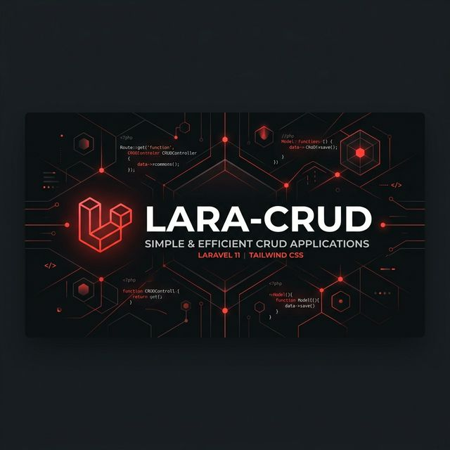
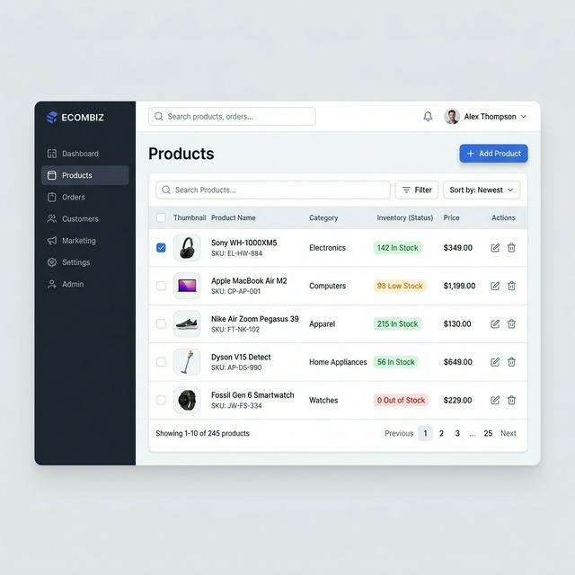

<p align="center">
  
</p>

<h1 align="center">🚀 LARA-CRUD</h1>

<p align="center">
  <strong>A Premium, Responsive Product Management System built with Laravel 11.</strong>
</p>

<p align="center">
  
  
  
  
</p>

---

## ✨ Overview

**LARA-CRUD** is a streamlined yet powerful Product Management System designed for developers who need a solid foundation for CRUD operations. It combines the elegance of Laravel 11 with the speed of Bootstrap 5 to deliver a professional-grade administrative experience.

<p align="center">
  
</p>

## 🌟 Key Features

- **📦 Full CRUD Lifecycle**: Effortlessly create, view, update, and delete product profiles.
- **🖼️ Smart Image Uploads**: Built-in logic for handling product thumbnails and storage.
- **🎨 Premium UI/UX**: Crafted with Bootstrap 5 and customized for a modern, high-end feel.
- **🔔 Real-time Alerts**: Integrated with **SweetAlert2** for intuitive user feedback and validation errors.
- **🛡️ Secure & Validated**: robust backend validation ensuring data integrity at every step.

---

## 🛠️ Tech Stack

| Technology | Purpose |
| :--- | :--- |
| **Laravel 11** | Backend Framework |
| **PHP 8.2+** | Core Language |
| **Bootstrap 5** | Responsive Frontend Styling |
| **SweetAlert2** | Interactive Notifications |
| **Vite** | Frontend Asset Bundling |
| **MySQL / SQLite** | Data Persistence |

---

## 📸 Database Architecture

| Field | Type | Connectivity |
| :--- | :--- | :--- |
| `id` | `BigInt` | Primary Key |
| `title` | `String` | Product Name |
| `discriptions` | `LongText` | Detailed Specifications |
| `image` | `String` | Asset Path |

---

## ⚙️ Quick Start

### 1. Project Initialization
```bash
# Clone the repository
git clone https://github.com/ChamathSadaru/LARA-CRUD.git
cd LARA-CRUD

# Install PHP & JS dependencies
composer install
npm install && npm run build
```

### 2. Environment Setup
```bash
# Prepare environment file
cp .env.example .env
php artisan key:generate

# Configure your database in .env, then migrate
php artisan migrate
```

### 3. Launch
```bash
php artisan serve
```

---

## 📖 Roadmap & Usage

- **Add Products**: Instant entry via the `/` route with live validation.
- **Manage Inventory**: View all items at `/show_product`.
- **Edit on the Fly**: Seamless updates through the dedicated `/update_product/{id}` view.

---

## 🤝 Contributing

Contributions are what make the open-source community such an amazing place to learn, inspire, and create. Any contributions you make are **greatly appreciated**.

1. Fork the Project
2. Create your Feature Branch (`git checkout -b feature/AmazingFeature`)
3. Commit your Changes (`git commit -m 'Add some AmazingFeature'`)
4. Push to the Branch (`git push origin feature/AmazingFeature`)
5. Open a Pull Request

## 📄 License

Distributed under the MIT License. See `LICENSE` for more information.

<p align="right">(<a href="#top">back to top</a>)</p>
